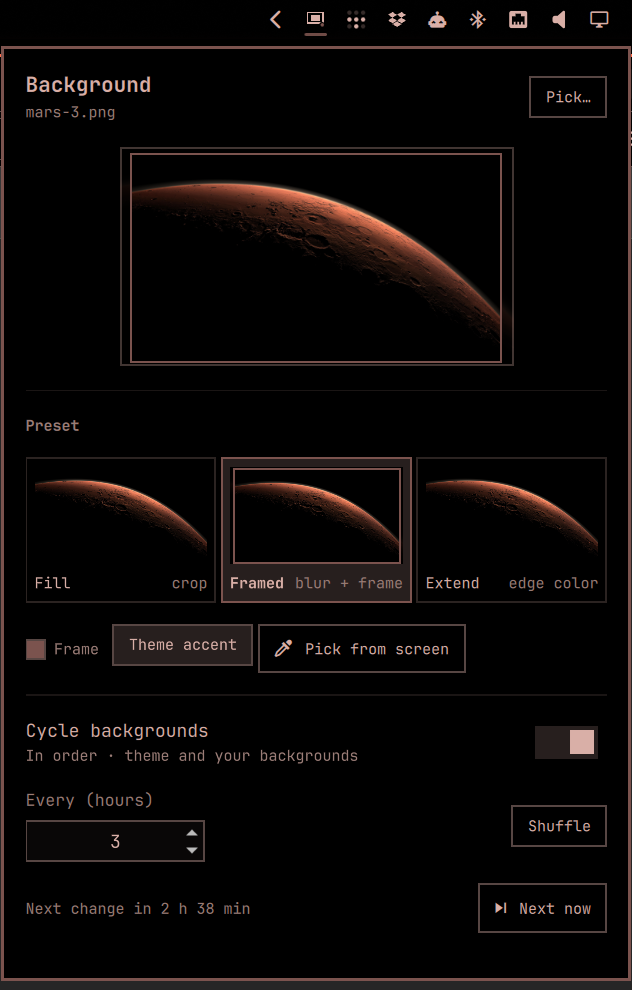

# Background Display for Omarchy

Omarchy's default fill mode works well for most displays, but on ultrawide monitors it can crop away large parts of a wallpaper or cut the subject in awkward places. Background Display gives you a few simple alternatives while keeping the stock behavior one click away.

Everything lives in a bar icon and its panel; there are no menu entries and no separate app.

- **Fill / Fit, per display** — Fill crops to cover the screen; Fit shows the whole image.
- **Background** — fill the space around a fitted image with a blurred copy, its sampled edge color, or a custom color picked from the screen.
- **Optional frame** — add a border in the theme accent or a color picked from the screen.
- **Independent spacing** — set the image's inset in logical pixels, and separately choose whether it keeps clear of the bar. Neither requires a frame.
- **Real previews** — the panel draws your current background with each display's settings.
- **Cycling** — move on to the next background every few hours, in Omarchy's order or shuffled, counted from the last time it changed. Right-click the icon for the next one now.

## The panel



## Preview

**Fit with Blur and Frame** — instead of cropping the wallpaper on an ultrawide display:


the full composition is preserved over a blurred background:


**Fit with Image color** — instead of cropping a centered design:


the sampled edge color fills the remaining space:


## Requirements

- Omarchy 4 / Quattro
- ImageMagick (`magick`) for automatic edge-color detection
- Perl for bounded, no-follow wallpaper reads
- `hyprpicker` for picking a color from the screen

These are included with a standard Omarchy installation. The plugin runs inside `omarchy-shell` with normal user permissions; it uses no network access or privilege escalation.

## Install

```sh
omarchy plugin add https://github.com/fchtngr/omarchy-background-display.git --yes
omarchy plugin enable io.github.fchtngr.background-display
```

Enabling puts the icon on the right of the bar and takes over from Omarchy's own background service, which is switched off while this one is on. Move the icon with `omarchy plugin enable io.github.fchtngr.background-display <section>`.

## Settings

The panel writes `~/.config/omarchy/background-display.json`, and the background follows the file, so hand-edits apply too:

```json
{
  "mode": "fill",
  "background": "blur",
  "frame": false,
  "spacing": 0,
  "avoidBar": false,
  "frameColor": "",
  "backgroundColor": "",
  "displays": {
    "DP-3": {
      "mode": "fit",
      "background": "image",
      "frame": false,
      "spacing": 24,
      "avoidBar": true,
      "frameColor": "",
      "backgroundColor": ""
    }
  },
  "cycleHours": 4,
  "shuffle": false
}
```

Top-level appearance options apply to every display; `displays` holds complete appearances for displays with their own settings. Choosing an option for **All displays** applies the panel's shown appearance to all displays and clears their overrides. Cycling is shared.

`mode` is `fill` or `fit`. Fit's `background` is `blur`, `image` (sampled edge color), or `color` (custom color). Empty `frameColor` and `backgroundColor` follow the theme accent and theme background respectively. `frame` enables a 3 px border. `spacing` (0–256 logical px) insets the image from the screen edges; a frame always has at least enough room to remain visible. `avoidBar` reserves the bar's space independently. Fill ignores these options but remembers them when returning to Fit. Videos continue to use Omarchy's video background rendering. `cycleHours` 0 turns cycling off.

Old `framed` and `extend` presets, including per-display choices and custom colors, are read automatically and saved in the new format on the next edit. Framed becomes Fit + Blur + Frame with 24 px spacing and bar clearance. Extend becomes Fit + Image color, or Custom color if an edge color was set.

The preview images above show the equivalent appearances from the previous panel.

## Remove

Disabling brings Omarchy's own background service back:

```sh
omarchy plugin disable io.github.fchtngr.background-display
omarchy plugin remove io.github.fchtngr.background-display
```

## Validate

```sh
omarchy plugin validate .
node --test tests/
./sample-edge-color --self-test
```

## License

[MIT](LICENSE). The renderer is derived from Omarchy's MIT-licensed background plugin.
