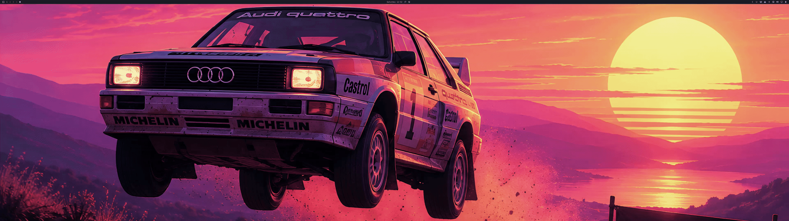
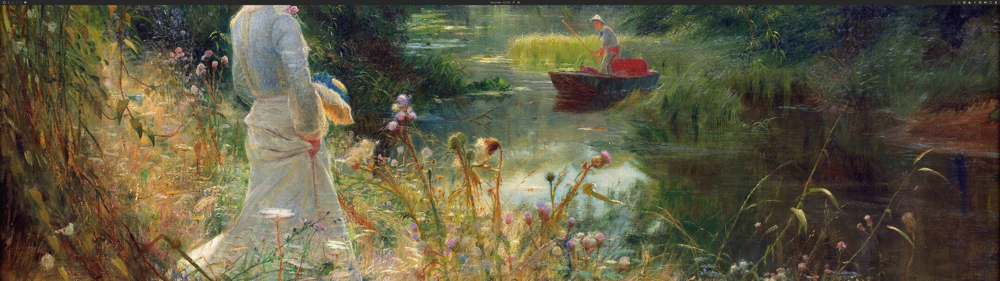
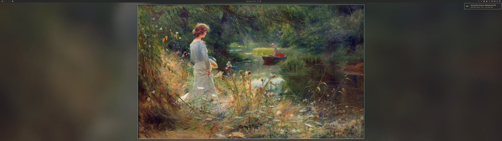
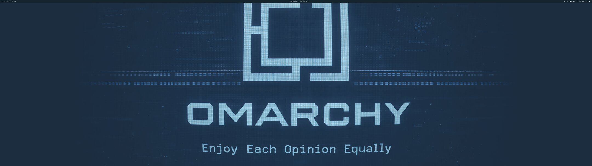
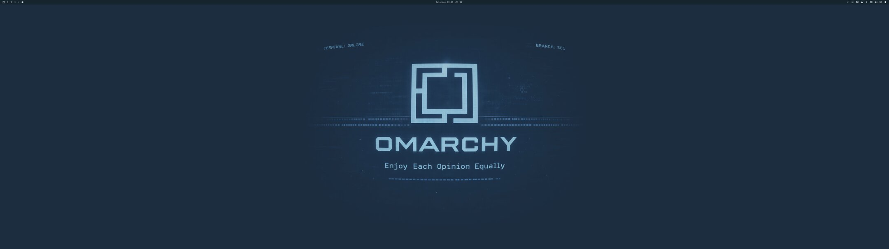

# Background Display for Omarchy

Omarchy's default fill mode works well for most displays, but on ultrawide monitors it can crop away large parts of a wallpaper or cut the subject in awkward places. Background Display gives you a few simple alternatives while keeping the stock behavior one click away.

Choose from three display modes:

- **Fill (Default)** — Omarchy's standard cropped, edge-to-edge wallpaper.
- **Framed** — preserves the image's aspect ratio over a blurred ambient background with a theme-accent frame.
- **Extend Edges** — preserves the image's aspect ratio and fills the remaining space with a color detected from its outer edge.

## Preview

**Menu flow:**



**Framed** — instead of cropping the wallpaper on an ultrawide display:



the full composition is preserved over a blurred background:



**Extend Edges** — instead of cropping a centered design:



the sampled edge color fills the remaining space:



Settings live under **Style → Background Display** in the Omarchy menu. Framed and Extend Edges also offer contextual color controls. **Pick From Screen** uses the same `hyprpicker` tool as `Super+Print`.

## Requirements

- Omarchy 4 / Quattro
- ImageMagick (`magick`) for automatic edge-color detection
- Perl for bounded, no-follow wallpaper reads
- `hyprpicker` and `wl-clipboard` for picking a custom color from the screen

These are included with a standard Omarchy installation. The plugin runs inside `omarchy-shell` with normal user permissions; it uses no network access or privilege escalation.

## Install

Install the plugin without enabling it yet:

```sh
omarchy plugin add https://github.com/fchtngr/omarchy-background-display.git --yes
```

It replaces Omarchy's stock background service, so switch services explicitly:

```sh
omarchy plugin disable omarchy.background
omarchy plugin enable io.github.fchtngr.background-display
```

If the second command fails, restore the stock service with `omarchy plugin enable omarchy.background`.

To add the settings menu without overwriting your existing configuration, open:

```text
~/.config/omarchy/extensions/omarchy-menu.jsonc
```

Copy the entries from the installed plugin's `omarchy-menu.jsonc` into that file's existing top-level object, then reload it:

```sh
omarchy menu refresh
```

## Usage

Open **Style → Background Display** and choose a mode. The current mode is marked with a check.

- **Frame Color → Theme Accent** restores the live theme accent.
- **Extend Color → Auto Detect** restores automatic edge sampling; when sampling fails, the theme background color is used.
- **Pick From Screen** starts `hyprpicker`, applies the selected color, and copies it to the clipboard.

Preferences are stored in the plugin's entry in `~/.config/omarchy/shell.json`.

## Remove

First remove every `style.background-layout…` entry from `~/.config/omarchy/extensions/omarchy-menu.jsonc`, then run `omarchy menu refresh`.

Restore the stock background service before removing the plugin:

```sh
omarchy plugin disable io.github.fchtngr.background-display
omarchy plugin enable omarchy.background
omarchy plugin remove io.github.fchtngr.background-display
```

## Validate

```sh
omarchy plugin validate .
./sample-edge-color --self-test
bash -n sample-edge-color pick-color
```

## License

[MIT](LICENSE). The renderer is derived from Omarchy's MIT-licensed background plugin.
